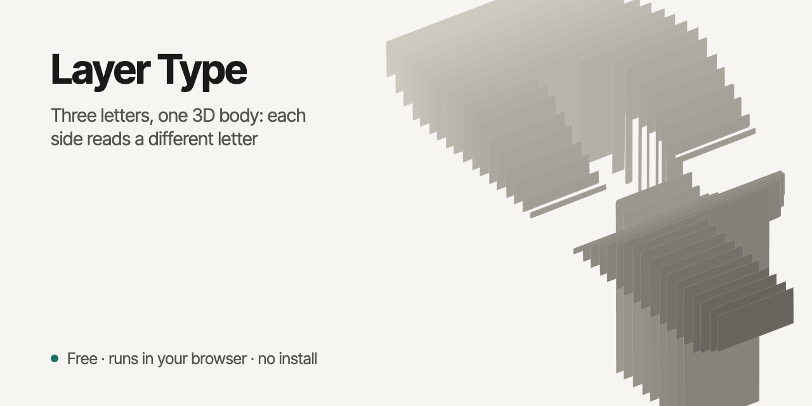
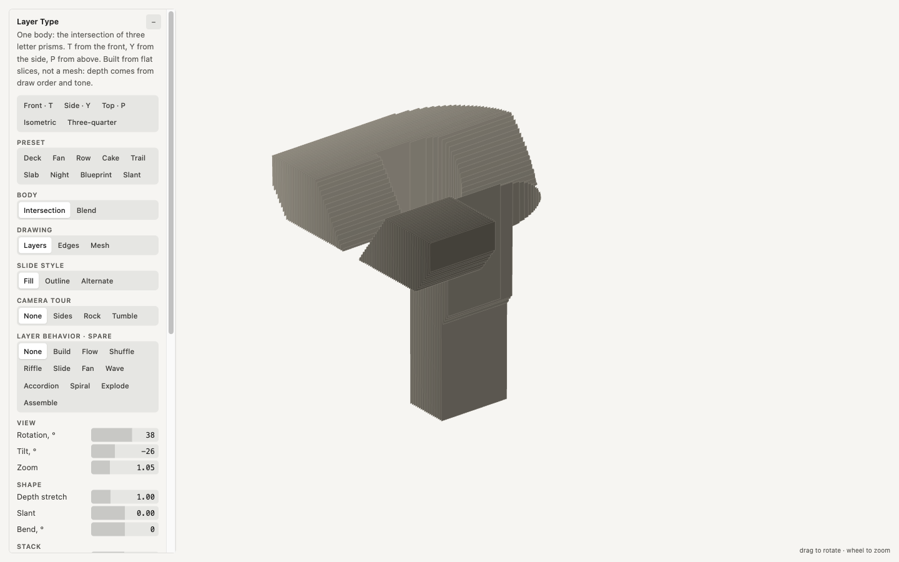

<p align="center"></p>

# Layer Type

Three letters become one layered 3D body. The first letter reads from the front, the second from the side, the third from above. It is the intersection of three letter prisms, cut into flat slices, so you can fan it out like a deck of cards, spread it as a layer cake, or draw it as a blueprint.

One HTML page. No server and nothing to install to view it. A small Python script rebuilds the page for any three letters.



## Open it

Open `index.html` in a modern browser. It shows the letters **TYP**. Drag to rotate, scroll to zoom, change the preset on the panel. **Export frame** saves the current view as SVG or PNG; the SVG is built from the same shapes the canvas draws.

## Use your own letters

```sh
python3 -m venv .venv && . .venv/bin/activate
pip install -r requirements.txt
python3 build.py ABC                 # writes index.html for A, B, C
python3 build.py ABC --out abc.html  # or somewhere else
```

The letters are given as front, side, top. Not every triple makes a body: the three prisms have to overlap. The script prints how much of each letter still shows in the body's shadow (the match is above 90 % for the default **TYP**) and stops when the overlap is too small. Capitals with heavy strokes work best. Try a few orders of the same letters; swapping them changes which one reads from the front.

Use another font with `--font path/to/font.ttf` (a variable font takes `--weight`). The font must contain your letters. The bundled Figtree covers Latin letters only.

## What is on the panel

- **Body**: Intersection (one body, three readings) or Blend (the stack flows from the first letter to the second to the third).
- **Drawing**: Layers (flat slides), Edges (a line drawing with hidden lines removed), Mesh (one smooth surface drawn along its form edges).
- **Presets**: Deck, Fan, Row, Cake, Trail, Slab, Night, Blueprint, Slant.
- **Shape**: depth stretch, slant, bend, stack twist. **Stack**: how many slides, solidity, layer spacing, spread. **Color**: near layer, far layer, background, fade curve, tone steps and wave.
- **Motion**: spin, camera tours (front, side, top in turn; rock; tumble) and layer behaviors (shuffle, riffle, wave, spiral, explode, assemble and more).
- Every number can be dragged, typed, or stepped with the arrow keys (Shift = 10x). Typing a value beyond the slider range widens the range.
- Reduced motion is respected: with it on, the spin, tours and layer behaviors start switched off.

## How it is built

`build.py` draws each letter from the font outline, turns it into a signed distance field, and takes the maximum of the three fields: that is the intersection, with smooth edges on any grid. Flat slices come from the zero level of that field (marching squares). The mesh comes from marching cubes on the same field, with volume-preserving smoothing and decimation to about 3000 triangles. The Blend stack morphs between the letters on distance, so counters open and close by themselves. `template.html` is the viewer; the script fills three data slots in it and writes `index.html`.

## Requirements

Viewing: any current browser (Canvas 2D). Rebuilding: Python 3.9+ with the packages in `requirements.txt`.

## License

MIT, see [LICENSE](LICENSE). The bundled font Figtree is under the SIL Open Font License 1.1, see [fonts/OFL.txt](fonts/OFL.txt).
